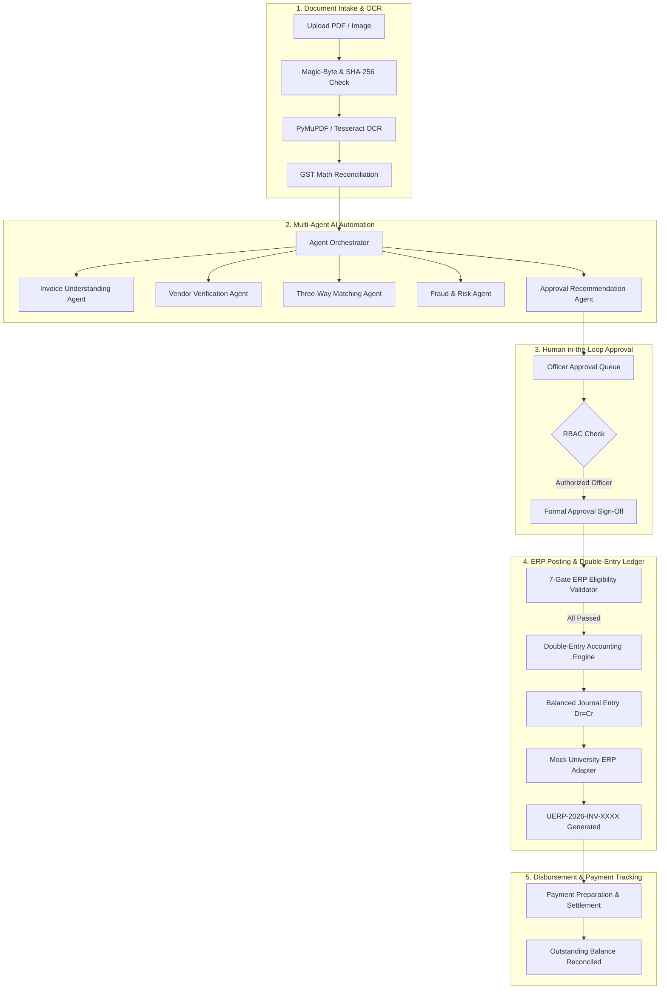

# Bahi-AI — Intelligent Accounts Payable & Vendor Invoice Automation Agent

**Bahi-AI** is an AI-powered Accounts Payable (AP) and Vendor Invoice Automation platform engineered specifically for university financial operations and procurement departments. It automates invoice intake, OCR document extraction, 3-way matching against Purchase Orders (PO) and Goods Receipt Notes (GRN), fraud/risk analysis, departmental budget tracking, multi-level approval workflows, and balanced double-entry General Ledger ERP posting with human-in-the-loop governance.

---

## 1. Problem Statement & Key Objectives

University accounts payable departments face significant operational challenges:
- High volumes of multi-format supplier invoices (PDF, scanned images, handwritten bills).
- Manual and error-prone cross-verification against Purchase Orders and physical Goods Receipts.
- Complex regional tax structures requiring statutory GST reconciliation (CGST, SGST, IGST).
- Strict cost-center budget constraints across faculties requiring encumbrance tracking.
- Risk of duplicate billing, vendor overbilling, and clerical transcription errors.

### Key Objectives:
1. **Intelligent Document Intake:** Ingest PDF/image invoices with automatic magic-byte verification, SHA-256 deduplication, and OCR text extraction.
2. **Multi-Agent AI Automation:** Deploy 5 specialized agents for invoice understanding, vendor verification, 3-way matching, fraud detection, and policy-compliant approval recommendations.
3. **Double-Entry Accounting Engine:** Generate mathematically balanced journal vouchers ($\sum \text{Debit} \equiv \sum \text{Credit}$) with penny rounding to Account `5099`.
4. **ERP Synchronization:** Integrate with a modular ERP adapter layer featuring strict 7-gate posting eligibility checks and idempotent document reference generation.
5. **Partial Disbursement & Settlement:** Support partial disbursements with dynamic outstanding balance tracking ($\text{Invoiced} - \text{Settled}$) and settlement simulation.
6. **Enterprise Governance:** Enforce Role-Based Access Control (RBAC), Argon2id password security, signed JWT authentication, and immutable audit logging.

---

## 2. Technology Stack

### Backend
- **Python:** 3.9.6
- **Web Framework:** FastAPI (Asynchronous REST API)
- **ORM & Database:** SQLAlchemy 2.0 & PostgreSQL 16 (via Psycopg 3)
- **Migrations:** Alembic
- **Document OCR:** PyMuPDF, Tesseract OCR, Pillow
- **Validation:** Pydantic v2
- **Authentication & Security:** Argon2id (`pwdlib`), PyJWT (HS256)
- **Testing:** Pytest & FastAPI TestClient (56 automated tests)

### Frontend
- **Framework:** Next.js 15 (App Router, Server & Client Components)
- **Language:** TypeScript 5
- **Styling:** Tailwind CSS
- **Icons:** Lucide React

### Infrastructure
- **Containerization:** Docker & Docker Compose (PostgreSQL 16 on port 5434)
- **ERP Integration:** Modular adapter interface (Mock University ERP, SAP, Oracle Cloud, REST)

---

## 3. System Architecture & High-Level Flow



---

## 4. Project Folder Structure

```
Bahi-AI/
├── .env.example                  # Environment configuration template
├── .gitignore                    # Version control ignore rules (protects DB dumps & uploads)
├── docker-compose.yml            # PostgreSQL 16 container definition (Port 5434)
├── README.md                     # Main project documentation
├── docs/                         # Detailed technical documentation
│   ├── ARCHITECTURE.md           # Architecture, component boundaries, and data flow
│   ├── DEMO_GUIDE.md             # Step-by-step 15-step university demonstration guide
│   ├── SECURITY_AUDIT.md         # Vulnerability analysis, fixes, and threat model
│   └── TESTING.md                # Automated test suite coverage and execution guide
├── backend/                      # FastAPI Python Backend
│   ├── alembic/                  # Database migration scripts
│   ├── app/
│   │   ├── api/routes/           # REST API routes (auth, invoices, erp, ledger, payments, etc.)
│   │   ├── core/                 # Config, database session, security, and RBAC dependencies
│   │   ├── models/               # SQLAlchemy 2.0 ORM database models
│   │   ├── schemas/              # Pydantic v2 schemas
│   │   ├── services/             # Core business logic services
│   │   │   ├── agents/           # 5 Specialized AI agents and Orchestrator
│   │   │   ├── erp/              # Accounting engine, posting service, sync queue, adapters
│   │   │   ├── extraction_service.py # OCR parsing and GST field extraction
│   │   │   └── ocr_service.py    # PyMuPDF and Tesseract document extraction
│   │   └── utils/file_handler.py # Upload validation and path-traversal sandboxing
│   ├── tests/                    # 56 Pytest integration & unit tests
│   └── requirements.txt          # Python dependencies
└── frontend/                     # Next.js 15 TypeScript Frontend
    ├── src/
    │   ├── app/                  # Next.js App Router pages (dashboard, invoices, ledger, etc.)
    │   ├── components/           # Reusable UI widgets, modals, layout components
    │   ├── services/api.ts       # Typed frontend API client
    │   └── types/index.ts        # TypeScript interface definitions
    └── package.json              # Frontend dependencies
```

---

## 5. Local Setup Instructions (macOS)

### Prerequisites
- Python 3.9+ installed (`python3 --version`)
- Node.js 18+ and npm installed (`node --version`)
- Docker Desktop running on macOS

### 1. Database Setup via Docker Compose
```bash
# Start PostgreSQL container on port 5434
docker compose up -d

# Verify container is healthy
docker ps --filter "name=bahi_ai_postgres"
```

### 2. Backend Setup & Startup
```bash
cd backend

# Create and activate Python virtual environment
python3 -m venv .venv
source .venv/bin/activate

# Install dependencies
pip install -r requirements.txt

# Configure environment file
cp .env.example .env

# Run database migrations to head revision
alembic upgrade head

# Start FastAPI development server
uvicorn app.main:app --reload --host 0.0.0.0 --port 8000
```
- API Base URL: `http://localhost:8000`
- Interactive Swagger UI: `http://localhost:8000/docs`

### 3. Frontend Setup & Startup
```bash
cd frontend

# Install dependencies
npm install

# Start Next.js development server
npm run dev
```
- Frontend Application URL: `http://localhost:3000`

---

## 6. University Demonstration & Evaluator Walkthrough

An interactive in-app **Demo Guide** is accessible via the top-right header button or directly in [`docs/DEMO_GUIDE.md`](docs/DEMO_GUIDE.md).

### Pre-Seeded Demonstration Accounts (Password: `BahiAI@2025!`):
- **Finance Administrator:** `sarah.jenkins@university.edu`
- **Finance Officer:** `robert.vance@university.edu`
- **Procurement Officer:** `marcus.chen@university.edu`
- **HOD Computer Science:** `alan.turing@university.edu`
- **Vendor Representative:** `accounts@apexcomputing.demo`

### Quick 15-Step Evaluator Path:
1. **Sign In:** Log in at `/login` or select a role using the top-right header menu.
2. **Dashboard Overview:** Review campus budget KPIs and pending action queues at `/dashboard`.
3. **Invoice Upload:** Upload a PDF invoice at `/invoices/upload` with instant magic-byte validation.
4. **OCR Extraction:** Observe real-time field extraction (Vendor, GSTIN, Subtotal, CGST, SGST, Total).
5. **Invoice Detail:** View `/invoices/1` showing live mathematical reconciliation.
6. **5-Agent Hub:** Review automated findings from the 5 AI agents and policy recommendations.
7. **3-Way Matching:** Cross-verify PO lines and GRN quantities at `/matching`.
8. **Fraud & Risk Scoring:** Check flagged overbilling or duplicate alerts at `/fraud`.
9. **Human Approval:** Formally authorize the invoice at `/approvals` (RBAC enforced).
10. **Eligibility Gates:** Check 7-gate ERP posting validation on the invoice detail page.
11. **Post to ERP:** Click "Post to Mock University ERP" to dispatch voucher and obtain reference `UERP-2026-INV-XXXX`.
12. **General Ledger:** View balanced vouchers where $\sum \text{Debit} == \sum \text{Credit}$ at `/ledger`.
13. **Trial Balance:** Confirm zero variance ($\text{Net Variance} == ₹0.00$) at `/ledger` (Trial Balance tab).
14. **Partial Settlement:** Prepare partial disbursement and simulate settlement at `/payments`.
15. **Audit Trail:** Review immutable timestamped system logs at `/audit`.

---

## 7. Testing & Build Verification

The test suite contains **56 automated integration and unit tests**:
```bash
# Run complete backend test suite
cd backend
.venv/bin/pytest tests/ -v

# Run Next.js production build verification
cd frontend
npm run build
```

Full test specifications and regression test details are documented in [`docs/TESTING.md`](docs/TESTING.md).

---

## 8. Limitations & Security Notes

- **Mock ERP & Simulated Banking:** All external ERP integrations (Mock University ERP, SAP, Oracle stubs) and ACH/Wire payment settlements operate in simulated mode. No real money or live ERP production databases are affected.
- **Human-in-the-Loop Governance:** AI agent recommendations are strictly advisory. The system never executes autonomous financial postings or approvals.
- **Security Audit Summary:** Comprehensive security audit findings, path-traversal sandboxing, and RBAC implementations are documented in [`docs/SECURITY_AUDIT.md`](docs/SECURITY_AUDIT.md).
