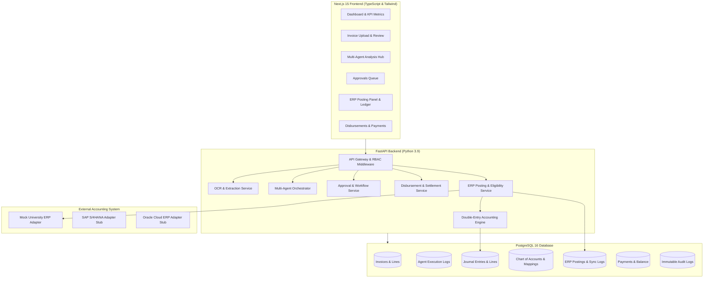
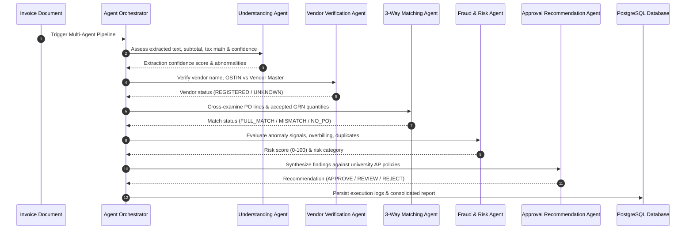

# Bahi-AI — System Architecture & Data Flow

This document details the system architecture, component boundaries, multi-agent AI pipeline, double-entry accounting engine, and ERP synchronization infrastructure of **Bahi-AI** (University Accounts Payable Automation Agent).

---

## 1. High-Level Architecture Overview

Bahi-AI connects the invoice intake portal with university procurement, multi-agent AI verification, financial ledger posting, and disbursement simulation.

---

## 2. Multi-Agent AI Automation Architecture

The system utilizes an orchestrator and five specialized agents that process invoices after OCR extraction:

### Agent Roles & Guardrails:
1. **Gemini Dynamic AP Orchestrator (`DynamicAPOrchestrator`):** An LLM-led bounded reasoning engine powered by Google Gemini (`gemini-3.5-flash-lite`). Dynamically inspects evidence and decides which tools to invoke based on findings rather than following a static hardcoded pipeline. Enforces an 8-tool call limit, 10-iteration loop cap, and loop detection preventing redundant calls.
2. **Safe Tool Registry (13 Registered Backend Tools):**
   - `get_invoice_details`: Verified invoice header, lines, and OCR metadata.
   - `get_vendor_details`: Official vendor master directory record.
   - `verify_vendor_status`: GSTIN match and active status verification.
   - `get_purchase_order`: PO contracted rates and quantities.
   - `get_grn_details`: Physical Goods Receipt Notes and accepted counts.
   - `check_duplicate_invoice`: SHA-256 hash and normalized number collision check.
   - `validate_invoice_totals`: Clerical reconciliation (Subtotal + Tax == Total).
   - `check_department_budget`: Cost center encumbrance and available balance.
   - `run_three_way_matching`: 3-way line matching across invoice, PO, and GRN.
   - `run_fraud_analysis`: 7-dimension composite fraud risk score (0-100).
   - `run_invoice_understanding`: OCR quality, missing fields, and tax type.
   - `get_applicable_approval_policy`: Policy delegation tier determination.
   - `request_human_review`: Concludes orchestration and formats recommendation for human review.
3. **Hard Financial Safety Guardrails (Non-autonomous Policy):** AI and agents NEVER approve invoices, NEVER disburse funds, and NEVER post to ERP autonomously. All sensitive financial actions require human officer sign-off.
4. **Prompt Injection & Untrusted Data Defense:** All raw document OCR and vendor-supplied text are enclosed in `<untrusted_document_content>...</untrusted_document_content>`. System instructions strictly direct the LLM to treat content within these tags as passive untrusted data and ignore embedded directives.
5. **Deterministic 5-Agent Fallback:** If Gemini is unavailable, rate-limited, or times out, the system automatically falls back to the deterministic 5-agent pipeline (`InvoiceUnderstandingAgent`, `VendorVerificationAgent`, `ThreeWayMatchingAgent`, `FraudRiskAgent`, `ApprovalRecommendationAgent`), setting `orchestration_mode = "FALLBACK_RULE_BASED"`.

---

## 3. Double-Entry Accounting Engine

The double-entry engine (`backend/app/services/erp/accounting_engine.py`) enforces strict financial balancing:

### Chart of Accounts Structure:
- **1101:** University Operating Bank Account (Asset)
- **1401:** Input Tax Credit — CGST (Asset)
- **1402:** Input Tax Credit — SGST (Asset)
- **1403:** Input Tax Credit — IGST (Asset)
- **2101:** Accounts Payable — Trade Creditors (Liability)
- **5001:** Department Operating Expenses (Expense)
- **5002:** IT Hardware & Software Licensing (Expense)
- **5003:** Office Supplies & Stationery (Expense)
- **5004:** Lab Equipment & Research Consumables (Expense)
- **5005:** Professional & Consulting Services (Expense)
- **5099:** Rounding & Penny Variance Adjustments (Expense)

### Double-Entry Invariance:
For every transaction:
$$\sum \text{Debits} \equiv \sum \text{Credits}$$
- **Pre-tax expenses:** Debited to corresponding departmental cost accounts (`5001`–`5005`).
- **Statutory taxes:** Debited to asset accounts `1401` (CGST) and `1402` (SGST) for intra-state invoices; `1403` (IGST) for inter-state invoices.
- **Gross liability:** Credited to Accounts Payable Trade Creditors (`2101`).
- **Penny fractions:** Automatically balanced to `5099`.

---

## 4. ERP Adapter Interface & Synchronization Engine

The ERP layer utilizes an adapter pattern to separate core business logic from external protocols:

- `ERPAdapterInterface` ([`backend/app/services/erp/adapters/base.py`](file:///Users/bhanuupadhyay/Desktop/Bahi%20AI/Bahi-AI/backend/app/services/erp/adapters/base.py)): Defines methods `post_invoice()`, `check_connection()`, and `reverse_posting()`.
- `MockUniversityERPAdapter`: Realistic simulation generating `UERP-2026-INV-XXXX` references with simulated latency (100–300ms) and network failure injection for testing.
- `SAPAdapter`, `OracleERPAdapter`, `GenericRESTAdapter`: Pre-wired enterprise stubs ready for future enterprise connector bindings.
- **Strict 7-Gate Posting Validator:** Human approval check, non-duplicate check, positive total check, active vendor check, department assignment check, COA check, and currency validation.

